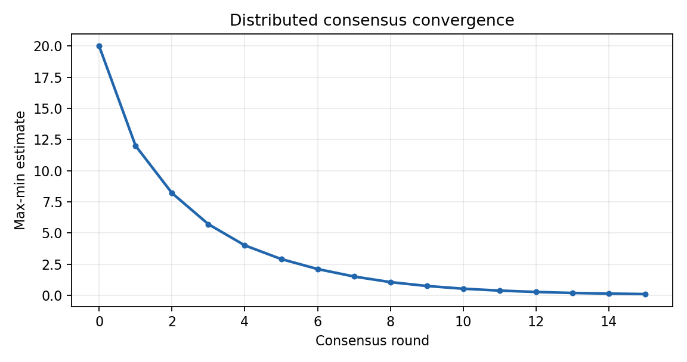

# SkyConsensus: Distributed UAV State Estimation

This project demonstrates a small distributed consensus loop for a UAV swarm. Five simulated agents exchange scalar estimates over UDP and update with the average of the latest neighbor values.

## Run

```text
python consensus_demo.py --agents 5 --rounds 40
```

Each agent binds a local UDP port and broadcasts its estimate to the other agents. The console prints the maximum disagreement after every round. The experiment is deterministic apart from the configured packet-drop model.

The example is intended for algorithm and networking experiments. It is not a substitute for a real-time flight stack, radio link, or safety monitor.



The plot shows the maximum estimate disagreement over consensus rounds.

## Message format

Each datagram contains JSON fields `sender`, `round`, and `value`. Stale rounds are ignored. The implementation keeps the communication layer separate from the update rule so the latter can be replaced by vector consensus or formation errors.

## License

MIT
